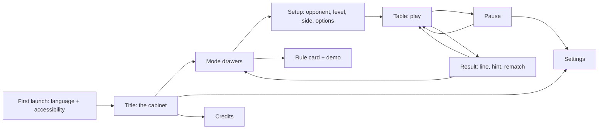

# Noughty Crosses: game design document

- **Updated:** 2026-10-15 (TTT-4.1.11).
- **Pitch:** [pitch](pitch.md).
- **Status:** accepted at TTT-G2 (2026-10-02). It changes with the code; see the change log.

## 1. Overview

- **Hook, experience goal and pillars:** in the [pitch](pitch.md#experience-goal-and-pillars).
- **Audience:** casual and puzzle players.
- **Platforms:** first the browser and a desktop app built from the same code. Steam
  (Linux, Windows, Steam Deck), then Android, after the game is playable
  (plan decision P4). **Input:** mouse, keyboard, controller and
  touch.
- **Sessions:** 1–10 minutes; one game takes 1–3 minutes.
- **Presentation:** every mode is played on a 3D tabletop in the crafted style
  ([style guide](style-guide.md)). A DOM mirror of the board carries input and
  accessibility, and a flat 2D board is a setting.

## 2. Rules

Shared rules (R1–R9) apply to every mode unless the mode overrides them. Each ID becomes a
test name, for example `test_R4_full_board_is_draw`.

| ID | Rule |
|---|---|
| R1 | Two sides, X and O, alternate turns. The side to move first is set per game (see R8). |
| R2 | A move is an action `{mode, cell, …}` validated by the rules core; illegal actions are rejected and change nothing. |
| R3 | A **line** is k marks of one side in a row, column or diagonal of the board; k is set per mode. |
| R4 | Completing a line wins (misère modes: loses). If no side can move and nobody has won, the game is a draw. |
| R5 | Every game ends. Each mode states why: board fills, ply cap, or repetition. |
| R6 | All randomness (computer choices, Ultimate's optional random opening) comes from one seeded generator stored with the game. |
| R7 | The game state is the move list plus mode settings; any position can be rebuilt by replaying moves. |
| R8 | Against the computer, the player chooses to move first, second or alternate. In pass-and-play, the first side alternates every rematch. |
| R9 | The result screen shows the winning line, the move count, and (vs computer) one hint: the first mistake the "Sharp" solver found, if any. |

## 3. Modes and structure

Each mode has a rule card (one sentence plus a 10-second animated demo), a fairness note
shown on its drawer, and three computer levels. Fairness facts come from the
mode research.

### 3.1 Classic (slice)

- **Rules:** a 3×3 board, k=3, the board fills → draw.
- **Fairness:** a draw with perfect play. Shown as "Perfect play draws".
- **Pillar:** the baseline everyone knows. It teaches the controls.

### 3.2 Vanishing (slice)

| ID | Rule |
|---|---|
| V1 | A 3×3 board, k=3. Each side keeps at most three marks. |
| V2 | When a side places its fourth mark, its oldest mark is removed **after** the new mark is placed. While choosing, the oldest mark still occupies its cell, and that cell cannot be chosen this turn. A line counts only on the board after the removal (clarified at TTT-3.1). |
| V3 | The very first move of the game may not be on an edge cell (the middle of a side). |
| V4 | The game is drawn on the third occurrence of the same position: same marks, same mark ages, same side to move. |
| V5 | The game is drawn after 60 plies without a winner (a backstop; no forced win needs more than 17). |
| V6 | The mark that will vanish next is shown fading, for both sides. |

- **Fairness:** with V2 and V3, perfect play draws. Without V3, the first player wins by
  opening on an edge, in 13 plies. The longest forced win anywhere is 17 plies. The rules
  core's own solver confirmed all three
  (evidence).
- **Pillar:** tempo and memory. The board never fills, so the tension never drops.

### 3.3 Misère

| ID | Rule |
|---|---|
| M1 | A 3×3 board, k=3, with Classic's moves (R1, R2). |
| M2 | Completing three of your own in a row **loses**: the other side wins. The result names that line as the losing line. |
| M3 | The board fills with no line → draw. |

- **Fairness:** perfect play draws, but the first player must open in the centre. Every
  other opening is a forced loss. The drawer shows: "Tip: there's only one safe first
  move".

### 3.4 Big board

| ID | Rule |
|---|---|
| B1 | A 5×5 board, with Classic's moves (R1, R2). |
| B2 | Four of your own in a row, along a row, a column or a diagonal, wins. |
| B3 | The board fills with no line → draw. |

- **Fairness:** a proven draw
  (research).

### 3.5 Gravity

| ID | Rule |
|---|---|
| G1 | A 6×6 board stands upright. A move picks a column that is not full, and the mark drops to the lowest empty cell of that column. |
| G2 | Four of your own in a row, along a row, a column or a diagonal, wins. |
| G3 | The board fills with no line → draw. |

- **Fairness:** a proven draw on 6×6 (Tromp). The 7-wide, 6-high size is avoided because
  it is a first-player win. We use a generic name, never the trademarked one.

### 3.6 Ultimate

| ID | Rule |
|---|---|
| U1 | Nine small 3×3 boards are arranged in a 3×3 big board. |
| U2 | The cell you play in a small board sends the opponent to the small board in the same position. |
| U3 | If that board is won or full, the opponent may play in any open small board. |
| U4 | Three in a row on a small board claims that board. A full small board without a line is dead and counts for nobody. |
| U5 | Three claimed small boards in a row win. The game is drawn when no line of three can still be claimed by either side. A side can still claim a line when each of its boards is claimed by that side, or open with a small line that holds none of the other side's marks. |
| U6 | Option ("Fair start", default off): the first four moves are random but seeded, as Diamond (2022) proposes against known opening wins. |

- **Fairness:** unsolved under these rules. Shown as "Unsolved: a test of skill".
- **UI:** the target board glows; when any open board will do, every open board glows. On
  the 3D table one large piece of the side that claimed a board replaces its small pieces;
  on the 2D board the large piece covers them and they fade. The winning line runs across
  the three boards' centres. On a phone, where the nine boards leave cells under 48 px
  deep, the camera closes in on the target board until they are 56 px deep, and draws back to
  all nine when any board will do or the game ends (TTT-4.4.2).

### 3.7 Notakto

| ID | Rule |
|---|---|
| N1 | Both sides place the same neutral X on one, two or three 3×3 boards, chosen at setup. |
| N2 | A board with three in a row is dead and takes no more marks. |
| N3 | Whoever kills the last live board **loses**. The result names that line as the losing line. |
| N4 | There are no draws: a board holds at most six X without a line, so every game ends within seven plies a board. |

- **Names:** both sides place X, so pass-and-play calls them Player 1 and Player 2.
- **Fairness:**
  - Solved by board count: odd counts are a first-player win, even counts a
    second-player win.
  - The setup screen states who wins with perfect play.
  - Against the computer, the player picks the board count and who starts, so the player
    can always choose the winning side.

### 3.8 Later modes

Two later modes are now scheduled before Steam (plan decision P13, 2026-10-15). Each
step writes its full rules table, with IDs, before it builds:
- **Overtime** (TTT-4.1.11), built; its rules are below.
- **Cube** (TTT-4.1.12), built; its rules are below (plan decision P16). Not in the 1.0
  cabinet: David rejected the layered look on 2026-10-30 (P28); it returns as a real 3D
  cube, after release, once a screenshot of the look is approved (root D22).

Misère wild (TTT-4.1.15, plan decision P21), Three men's morris (TTT-4.1.16), Saucer
(TTT-4.1.17), Order and Chaos (TTT-4.1.18) and Nesting, the size-stacking mode
(TTT-4.1.19, P22, P24), follow them; their rules are below. The rest of the later set,
7×7 or 8×8 with k=5 and gomoku with Swap2, waits (see the [pitch](pitch.md#scope)).

**Overtime** (TTT-4.1.11; a growing board,
research):

| ID | Rule |
|---|---|
| O1 | Classic on a 3×3 board (R1–R4). |
| O2 | A 3×3 draw does not end the game: a ring of 16 empty cells grows the board to 5×5. Every mark stays, now in the centre. |
| O3 | The side that did not make the ninth mark moves first on the 5×5 board. |
| O4 | On the 5×5 board, four of your own in a row, along a row, a column or a diagonal, wins (the Big board's lines, B2). |
| O5 | As soon as no line of four is open for either side (every line of four holds both marks), the game is a draw; the players do not fill the board. A full board with no line is a draw as well: the last cell can close the last open line. |

- **Fairness:** solved offline (`tools/solve-overtime.mjs`): every one of the 32 Classic
  draws stays a draw on the grown board, so perfect play draws from the start. The setup
  screen says "Perfect play draws, before and after the board grows."
  (research).
- **Few lines stay open:** after any 3×3 draw each side has 8–10 open lines of four out
  of 28. David's play (2026-10-30, P27): "it should have been declared a draw before, or
  keep growing"; O5 now ends the game at the dead board. The early draw changes no
  value: a dead board is a draw under both rules, so the offline solve stands. In 200
  scripted games a pairing, the grown board goes dead after 18–22 moves on average, 3 to
  7 moves before it would fill; Keen and Sharp never fill it now
  (play). A second growth
  to 7×7 at the dead board, his other option, is an "After release" row in the plan.
- **Record:** a move's cell is read on the board of its time, 3×3 before the growth and
  5×5 after it, so a game replays exactly (R7).

**Cube** (TTT-4.1.12; the user's idea, 2026-10-05; rules decided 2026-10-16, plan decision
P16, research). The old product
name for 4×4×4 is a trademark; this mode is "Cube".

| ID | Rule |
|---|---|
| C1 | A 4×4×4 cube of 64 cells. Players take turns placing their own mark on an empty cell (R2). |
| C2 | Four of your own in a straight line wins, in any of the 13 directions of the cube: rows, columns, pillars, the diagonals of a layer or a face, and the four space diagonals (76 lines). |
| C3 | After the 7th mark, if no one has won, the cube grows to 5×5×5: one layer of empty cells on the top, right and back faces (61 cells). Every mark keeps its place. |
| C4 | Turns keep alternating. The 7th mark is the first player's, so the second player moves first on the grown cube. |
| C5 | The cube grows once: 5×5×5 is the cap. Four in a line still wins (302 lines). A full cube with no line → draw. |
| C6 | Record: a move's cell is read on the cube of its time, 64 cells before the growth and 125 after it, so a game replays exactly (R7). |

- **Fairness:** unsolved. Plain 4×4×4 is a first-player win (Patashnik), and on an empty
  5×5×5 the side to move won every simulated game in 9 plies. The growth after an odd mark
  hands the grown cube's first move to the second player. In 200 simulated games each,
  Keen against Keen went 102 to 98 and Sharp against Sharp 123 to 77 in the rules research;
  the shipped code went 126 to 74 in both, so the first player wins about 63% between
  equal levels. Sides take turns to start, so over a series each player wins about half. The
  setup screen says "Not solved. The first player wins about 6 in 10 computer games. Sides
  take turns to start, so a series is even." (reworded in TTT-4.5; P16 had "Unsolved. In
  computer play each side wins about half the games. Sides take turns to start.").
- **Computer:** the Big board's levels with a 20,000-node budget, so Sharp moves within
  100 ms at 5×5×5: at most 64 ms in the desktop app; in Node 2 of 1,108 moves passed it,
  at 102.6 ms at most. Keen beats Casual in 72.5% of 200 simulated games
  (research).
- **Presentation:**
  - The X and O pieces float on glass layers one cell apart, over a base board, and the
    player turns the whole cube to see into it. Each empty cell is a small bead. The slow turning is an exception to render on demand; it stops under
    reduced motion.
  - **One active layer at a time:** the other layers dim. Mouse, keys and controller pick
    only in the active layer. The wheel, Page Up and Page Down, the shoulder buttons or
    the "Layer up" and "Layer down" buttons change the layer (§5). The camera does not
    zoom in Cube.
  - The 2D setting shows the layers side by side, and the DOM mirror is a layer-by-layer
    grid.
  - The growth adds the new layers in place, and the cube re-centres on the table.
  - **Phones:** the table frames the cube, as every board, in the free area beside or
    below the play panel, so the panel never hides its top layers (TTT-4.4.2).
  - **Budgets (§11):** the pieces use the lightest tier, and the empty lattice is one
    instanced mesh. They are measured on the busiest cube seen in simulations, 29 pieces:
    48 draw calls and 18.5k triangles at high. A full 5×5×5 cube of pieces would cost
    26.6k triangles alone.

**Misère wild** (TTT-4.1.15; the first mode from the later set, added at the user's ask
on 2026-10-19, plan decision P21,
research):

| ID | Rule |
|---|---|
| W1 | A 3×3 board. On each turn the side to move places an X or an O, its choice, on an empty cell. Both sides may place either mark. |
| W2 | Completing three of one mark in a row, all X or all O, loses for the side that placed it. |
| W3 | A full board with no line → draw. |
| W4 | Record: a move is its cell, plus 9 for an O (0–8 an X, 9–17 an O), so a game replays exactly (R7). |

- **Fairness:** solved by our solver (37,506 positions): perfect play draws, and the
  centre, with either mark, is the only first move that does not lose. The setup screen
  says "Perfect play draws. Tip: there's only one safe first move."
- **Sides:** they are named Player 1 and Player 2, as in Notakto, because both place
  both marks.
- **Choosing the mark:** the "Place X / Place O" button beside the board, the M key
  (remappable, "Swap mark") or the controller's Ⓧ button swaps the mark the player
  places next. The ghost piece on the board shows it. The button stands just right of the
  board, or under it when there is no room on the right, and shows the mark as a piece.
  It starts as X in each game.
- **Computer:** the shipped solved table and the usual levels (§4.1). In 400 simulated
  games each, Keen beat Casual in 88.5% and Sharp beat Keen in 30.5%. Casual's mistakes
  here are mostly placing the third mark of a line; judged with Misère's in TTT-4.2
  (P7, §4.1: a mistake, kept).

**Three men's morris** (TTT-4.1.16; a traditional game from the later set, plan decision
P21, research):

| ID | Rule |
|---|---|
| TM1 | A 3×3 board. Each side places its own pieces on empty cells, one a turn, until it has three on the board. The first piece of the game may not go in the centre. |
| TM2 | A side with three pieces down instead slides one of them to a neighbouring empty cell. Two cells are neighbours when they are next to each other on one of the 8 lines: a corner reaches its two edges and the centre, an edge its two corners and the centre, the centre every cell. |
| TM3 | Three of your own in a row, by a placement or by a slide, wins. |
| TM4 | The third occurrence of the same position (board and side to move) is a draw, and so is the 60th ply without a winner (as Vanishing's V4 and V5). |
| TM5 | Record: a placement is its cell (0–8); a slide is 9 + from × 9 + to (9–89), so a game replays exactly (R7). |

- **Fairness:** solved by our solver (7,722 positions, the longest forced win 10 plies):
  perfect play draws. A first piece in the centre would win in 8 plies, hence TM1. The
  setup screen says "Perfect play draws. No centre on the first move; a draw on a third
  repeat."
- **No side is ever boxed in:** three pieces with no empty neighbour need the centre and
  two more cells of the other side, and those make a line first. A check over every
  reachable position confirms it, so there is no rule for a side that cannot move.
- **Moving a piece:** a slide is two picks. The player picks one of their own pieces that
  can move; it lifts and is ringed in brass, and its neighbouring empty cells show the
  ghost piece. A pick on one of them slides it there; a pick on the piece again, or Esc
  or Ⓑ, puts it back. A pick on another own piece takes that one instead.
- **Computer:** the shipped solved table and the usual levels (§4.1). The table ignores
  TM4's draws, so the hint names a missed win in a drawn game, as in Vanishing. In 400
  simulated games each, Keen beat Casual in 94% and Sharp beat Keen in 67.5%, with no
  losses.

**Saucer** (TTT-4.1.17; the user's idea of characters that move pieces, 2026-10-19,
research):

| ID | Rule |
|---|---|
| S1 | Classic's board and lines (R1–R6): three in a row wins, a full board without one draws. A line made by the placement wins at once, before any visit. |
| S2 | The first piece of the game may not go in the centre. |
| S3 | After every third move of the game (moves 3, 6, 9), a flying saucer takes the piece just placed. On the board's edge it pushes the piece one cell clockwise around the edge, if that cell is empty, and leaves it where it is if not. From the centre it carries the piece away: the cell is empty again. |
| S4 | A push that completes three in a row for the piece's side wins. A full board after a visit draws. |
| S5 | Record: a move is its cell (0–8), as in Classic; the visits follow from the moves, so a game replays exactly (R7). A position is the board, the side to move and the move count modulo 3. |

- **Fairness:** solved by our solver (35,122 positions, the longest forced win 7 plies):
  perfect play draws from either side's start and from every legal first move. Without
  S2 the first player wins; with the saucer on the previous move's piece instead of the
  piece just placed, the second player wins (research). The setup screen says "Perfect
  play draws. No centre on the first move."
- **The saucer is never a surprise:** the side making a third move knows it, so a push
  is a move the player aims. The status line warns on that turn, the saucer waits by the
  board, and a low hum plays, as for a fading mark (§7).
- **The saucer:** made from primitives on the table (a disc, a glass dome, a ring of
  lights and a beam); no asset. It swoops onto the piece, lifts it in its beam and sets
  it down one cell on, puts it back, or flies off with it. In the 2D board the piece
  slides to its new cell, or rises and fades from the centre. Reduced motion shows the
  result at once.
- **Computer:** the shipped solved table and the usual levels (§4.1). In 400 simulated
  games each, Keen beat Casual in 73% and Sharp beat Keen in 18.5%, with no losses.
  A game has about 2.5 visits: 1 push, 1.4 left in place and 0.1 carried away.

**Order and Chaos** (TTT-4.1.18; Sniderman's game, *Games* 1981, under its generic name,
research):

| ID | Rule |
|---|---|
| OC1 | A 6×6 board. The side that moves first plays Order, the other Chaos. On each turn the side to move places an X or an O, its choice, on any empty cell. |
| OC2 | Five of one mark in a row, column or diagonal wins for Order, whoever placed the fifth. Six in a row holds a five, so it counts. |
| OC3 | Chaos wins as soon as no five can be made: every line of five cells holds both marks. A full board without a five is one such case. There are no draws. |
| OC4 | Record: moves 0–35 place an X on that cell, 36–71 an O on cell move − 36. A position is the board and the side to move. |
| OC5 | Roles follow the side setting: against the computer, First plays Order, Second plays Chaos, and Alternate swaps roles each game; in pass-and-play the roles swap each rematch (R8). |

- **Fairness:** not solved by us. Weak sources say Order wins with perfect play under
  these rules (six counts), and Chaos under the variant where six does not count
  (research). Our own self-play agrees: Sharp Order beats Sharp Chaos every game. So
  the mode is played in pairs: the rule card says "Order is thought to win with perfect
  play. Play two games, so each side has a turn as Order."
- **OC3 ends the game early:** once every line holds both marks, no move can change the
  result, so the board is not filled for nothing.
- **Sides are named by role:** "Order" and "Chaos" in the status and the result, not X
  and O, since both sides place both marks. Against the computer the status says the
  player's role until the player's first move, and the setup card names it.
- **The mark** is chosen as in Misère wild: the "Place X/O" button or the M key (§5).
- **Computer:** its own alpha-beta search in the worker (§4.1), since one move feeds or
  kills both marks' lines.

**Nesting** (TTT-4.1.19; size-stacking under our own name, plan decisions P22 and P24,
research):

| ID | Rule |
|---|---|
| NE1 | A 3×3 board. Each side has six pieces off the board: two small, two medium and two large. |
| NE2 | On a turn the side to move places one of its pieces from off the board, or moves one of its own top pieces to another cell. The piece goes on an empty cell or covers a smaller piece of either side; a covered piece stays under it and cannot move until it is uncovered. |
| NE3 | Only a cell's top piece counts: three top pieces of one side in a row make that side's line. |
| NE4 | After a move, if the other side has a line, the other side wins: a piece lifted off its line must land on that line to stop it. Otherwise a line of the mover's own wins. |
| NE5 | The third occurrence of the same position (every cell's stack and the side to move; the pieces off the board follow from them) is a draw, and so is the 60th ply without a winner (as TM4). |
| NE6 | Record: moves 0–26 place a piece, size × 9 + cell, small 0 to large 2; moves 27–107 move a top piece, 27 + from × 9 + to, so a game replays exactly (R7). |

- **Fairness:** not solved by us; the game has too many positions to ship as a table.
  Gobblet Gobblers, the commercial game with these rules, is often said to be a first
  player win, with no primary source found. Our Sharp against Sharp agrees: the first side
  won all 200 games. So the mode is played in pairs: the rule card says "The first player
  is thought to win with perfect play. Play two games, so each side starts once."
- **No side is ever stuck:** a side with a large piece on the board or off it can always
  place or move it, since at most four cells hold a large piece. So the mode has no rule
  for a side that cannot move.
- **What shows:** only the top piece of a cell, at its size, on the 3D table and the 2D
  board, as cups would hide what they cover. The player has to remember what is under.
- **Moving a piece:** a move is two picks. The player takes a piece from the tray beside
  the board, one stamp per size with the count left, or picks up one of their own top
  pieces on the board; then picks a cell where it fits. The ghost shows the piece held at
  its size. A pick on another of the player's movable pieces takes that one instead; a
  pick on the piece held, or Esc or Ⓑ, puts it back. M or Ⓧ takes the next size from the
  tray.
- **Computer:** its own alpha-beta search in the worker (§4.1).

## 4. Systems

### 4.1 Computer opponent

Three levels per mode: **Casual**, **Keen** and **Sharp**. The levels are designed by
mode family, following architecture and the
mode research.

- **Casual's self-losing moves** (P7, judged in TTT-4.2, 2026-10-29,
  research): in Misère and Notakto a missed
  "block" (40% of the time) is a move that loses at once, its own line or the last live
  board. Against Keen it is about one Casual move in ten in Misère and one in six on one
  Notakto board, with two to seven cells open, which is where a new player makes the same
  slip. It is kept as a mistake, not throwing: Casual is the level a new player should
  beat, and its noise is one rule for every solved mode. Revisit after release if
  players say it looks thrown.

| Mode family | Search | Casual | Keen | Sharp |
|---|---|---|---|---|
| Small solved (Classic, Misère, Vanishing, Notakto) | perfect-play table (minimax or retrograde, built at load or build time) | takes an immediate win 80% of the time, blocks 60%, misses forks; otherwise a random safe move | always wins and blocks; misses a fork 30% of the time | perfect; picks at random among equally good moves |
| Line games (Big board, Gravity) | alpha-beta, iterative deepening within a node budget, threat-count evaluation, transposition table | depth 2, evaluation noise, ignores an opponent's open three 30% of the time | depth 4, small noise | full node budget, no noise, never ignores a threat |
| Order and Chaos | alpha-beta from the mover's role, iterative deepening within a node budget, open-line evaluation, transposition table | depth 1, wide noise; as Chaos, misses Order's four 30% of the time | depth 2, small noise | full node budget, no noise |
| Nesting | alpha-beta, iterative deepening within a node budget, top-piece and threat evaluation, transposition table | depth 2, wide noise; 30% of the time looks one ply only and misses the reply | depth 4, small noise | full node budget, no noise |
| Ultimate | MCTS (UCT) with random playouts | 100 playouts; plays the most-visited move that claims a small board when one exists | 1,000 playouts | 5,000 playouts, sized to the time budget (TTT-4.1.5) |

- **Mistakes look human.** A mistake is chosen from the top few moves by
  score-weighted, seeded noise, never a random blunder when a win is on the board at Keen
  and above.
- **Thinking delay:** a 300–700 ms minimum, so the computer never feels instant.
- **Time budget:** 100 ms per move on the lowest target device, in a Web Worker. A move
  is always returned by the deadline.
- **Line games budget nodes, not time** (TTT-4.1.3). A clock would make the same seed
  play differently on a faster device (R6). Each move searches at most a fixed number of
  positions, sized so the slowest move fits the time budget: 40,000 on the Big board, at
  most 36 ms on a desktop. Casual there has no threat checks and wide noise; "open
  three" means a line one mark short of four with its last cell empty
  (research).
- **Gravity** (TTT-4.1.4) uses the same search and budget. Only a column's landing cell
  is a move, a win or a block. The evaluation adds a zugzwang term: the lowest waiting
  three in each column (a three whose empty cell is not yet playable) scores for the side
  whose row parity will fill it. Sharp is still not a solver: it loses about 10% of games
  to Keen and almost none to Casual
  (research).
- **Overtime** (TTT-4.1.11) plays Classic's levels on the 3×3 board, from Classic
  solved once in the search worker (about 50 ms in Node). This is the one mode that solves on the
  device. On the grown board it uses the Big board's search and levels, but Casual's noise
  is 200, not 100 (plan decision P15): around a drawn centre few lines stay open, and with
  the Big board's Casual, Keen won only 4% of the games that grew. Sharp's move takes at
  most 23 ms in Chromium and the desktop app
  (research).
- **Order and Chaos** (TTT-4.1.18) searches 40,000 nodes a move, from the role of the side
  to move. The evaluation, in Order's terms, sums the lines of five that still hold one
  mark only, weighted by their marks; Order raises it and Chaos lowers it. Each node first
  checks Order's fours: Order completes one; Chaos blocks a single four with the other
  mark and loses to two. Chaos weighs a line of two marks lower than Order does, so it
  spends its moves on threes; with Order's weights, Sharp Chaos held only 1 game in 10
  against Keen Order. A Sharp move takes at most 97 ms in Node on a desktop; half the
  budget halves the time but lets Keen Order beat Sharp Chaos in 86 games of 100, not 65
  (research).
- **Nesting** (TTT-4.1.19) searches 20,000 nodes a move. The evaluation sums the lines
  holding only one side's top pieces, weighted by how many, and the top pieces by size (a
  large one cannot be covered). A line of two whose third cell the side to move can take
  with a larger piece counts as nearly won, and two such cells for the other side as
  nearly lost. Positions seen twice in the game, or on the search's own path, count as
  draws (NE5). 40,000 nodes played no better against Keen and took twice as long. A Sharp
  move takes at most 70 ms in the cloud container's Chromium
  (research).
- **Ultimate** (TTT-4.1.5) budgets playouts, not time, for the same reason. Every level
  takes a game win when one is on the board. Sharp's 5,000 playouts take about 18 ms a
  move and at most 35 ms in Chromium (59 ms once, in a first run) and 42 ms in the desktop
  app, on a desktop; 10,000 took up to 66 ms and played no better against Keen. Sharp
  loses about 10% of games to Keen
  (research).
- **Targets,** measured by seeded simulation when each mode was built; the results stay
  as dated evidence in research and are no longer re-run (plan decision P12):
  - Sharp never loses a solved mode, and every mode ends within its cap.
  - Keen beats Casual in at least 70% of games:

    | Mode | Keen beats Casual | Evidence |
    |---|---|---|
    | Classic | **69%** (a quarter draw); judged at TTT-4.2 | TTT-3.2 |
    | Vanishing | 97% | TTT-3.2 |
    | Misère | 70.2% | TTT-4.1.1 |
    | Notakto | 92–93% | TTT-4.1.2 |
    | Big board | 77.8% | TTT-4.1.3 |
    | Gravity | 85.7% | TTT-4.1.4 |
    | Ultimate | 89.5% | TTT-4.1.5 |
    | Overtime | 71.5% | TTT-4.1.11 |
    | Cube | 72.5% | TTT-4.1.12 |
    | Misère wild | 88.5% (354 of 400) | TTT-4.1.15 |
    | Three men's morris | 94% (376 of 400) | TTT-4.1.16 |
    | Saucer | 73% (292 of 400) | TTT-4.1.17 |
    | Order and Chaos | 98% as Order, 39% as Chaos, the weaker role | TTT-4.1.18 |
    | Nesting | 88% (176 of 200) | TTT-4.1.19 |
- **Solved tables ship as data** (answered at TTT-3.2): the small solved modes load a
  byte table made at build time by our own solver (Vanishing 92 KB gzip), so nothing is
  solved on the device, except Classic for Overtime's computer (about 10,000 positions,
  above).

### 4.2 Hints

The result screen shows the first move where the Sharp solver's evaluation dropped, with
"Try instead" on the board. Solved modes only at launch.

### 4.3 Progress (light)

Per mode and level, the game keeps local counts of wins, draws and losses, and a badge on
the drawer for "beat Sharp" or "drew Sharp". These are stored only on the device. There
are no accounts and no achievements system.

## 5. Controls and input

| Action | Touch | Mouse | Keyboard | Controller |
|---|---|---|---|---|
| Choose cell or column | tap, acting on release | click | arrows + Enter or Space | d-pad or stick + A |
| Rotate or tilt the camera | two-finger drag | right-drag or wheel | Q and E, Page Up and Page Down | right stick |
| Change the layer (Cube) | Layer up and Layer down buttons | wheel or the buttons | Page Up and Page Down | shoulder buttons |
| Reset the camera | double tap on empty table | middle click | R | R3 |
| Swap the mark to place (Misère wild, Order and Chaos) | Place X / Place O button | the button | M | X |
| Move a piece (Three men's morris) | tap the piece, then the cell | click the piece, then the cell | arrows + Enter on each; Esc puts the piece back | A on each; B puts it back |
| Place or move a piece (Nesting) | tap a tray piece or your piece, then the cell | click a tray piece or your piece, then the cell | M takes the next tray size, or arrows + Enter on your piece; then Enter on the cell; Esc puts it back | X for the tray, or A on your piece; then A; B puts it back |
| Undo (vs computer, Casual and Keen only) | button | button | Ctrl+Z / U | Y |
| Pause or menu | button | Esc | Esc | Start or B |

- **Every action works with single presses.** No drag is ever needed: the camera has
  buttons too.
- **Undo** takes back the player's last move and the computer's reply. The generator
  rewinds with them, so the same move gets the same reply (R6). It is not offered against
  Sharp, in pass-and-play, or after the game ends.
- **Remapping:** the action keys can be remapped in Settings: rotate, tilt, reset the
  camera, undo, and swap the mark. The board's arrows, Enter and Space, Tab and Esc keep
  their jobs, as the standard board keys; Ctrl+Z always undoes. The controller keeps the standard layout;
  Steam Input remaps it on Steam (TTT-4.3).
- **Cube:** on the board, Page Up and Page Down change the layer instead of tilting, and
  the wheel changes the layer instead of zooming. The camera buttons still tilt. An action
  remapped to Page Up or Page Down changes the layer there too.
- **Activation happens on release.**
- **Glyphs** follow the device used last: the controller's prompts show once it is used.

## 6. Screens and flow

- **First launch:** language, text size, contrast, reduced motion and graphics level. OS settings are applied when they can be read.
- **Title:** the cabinet scene with Continue (when a game is saved), Play, Settings and
  Credits. Quit appears on desktop only.
- **Mode drawers:** one drawer per mode, showing its board in miniature, the rule line and
  the fairness note. The "?" opens the rule card and demo.
- **Setup:** opponent (computer or friend), level, side or alternate, and mode options
  (Notakto board count, Ultimate fair start).
- **Table:** the 3D scene, a status line ("Your move", "O is thinking…"), the vanishing
  indicator where relevant, and Pause.
- **Result:** the winning line glows, the move count, the hint, Rematch (sides swapped),
  Change mode.
- **Back:** every screen has a back path. Esc, B or Android's Back button always goes
  back one step; on the title Android's Back sends the app to the background.

## 7. Feedback

Each event has at least two channels. The style guide defines the look and sound.

| Event | Visual | Audio | Haptic (optional) |
|---|---|---|---|
| Hover or focus a legal cell | cell highlight + ghost piece | soft tick | — |
| Place a piece | piece drops and settles | wood or stone "clack" | short tap |
| Illegal move | cell shakes (fades under reduced motion) | dull thud | none |
| Mark about to vanish | pulsing fade | low hum on its turn | — |
| Win line | line glow + light sweep | chord | double tap |
| Draw | lamp dims, pieces settle | soft cadence | — |
| Computer thinking | lamp flicker / dots in status | none | — |
| Saucer: a visit (S3) | the saucer lifts the piece and pushes it, puts it back or carries it off; the status says which | "slide", or "vanish" when carried off | — |
| Order and Chaos: Chaos wins (OC3) | no line; the status says no five can be made | chord | double tap |
| Overtime: the board grows | the board widens to 5×5 and the ring's cells fade in; the status says the board grew | "slide" | — |

Off the board, the cabinet's doors and drawers, the cards and the buttons have their own
sounds (style guide, "Sound"). Gravity's piece slides down its column before it lands. The
cabinet has one music loop; the table has the other, played only when "Music during play"
is on (TTT-4.1.9).

## 8. Saves, settings and sessions

- **Autosave:** after every move, and when the app is hidden or goes to the background.
  The game is saved as `{version, setup, first, seed, moves, rng}`: the setup (mode,
  boards, opponent, level, side, fair start), the side that moved first, the seed, the
  moves, and the generator's state after the computer's last move (R6). Loading replays
  every move through the rules. A finished game is not kept. Progress is saved apart as
  `{version, counts}`. IndexedDB on the web; Capacitor and Tauri use the same web
  storage. Settings export and import are also offered on the web.
- **Save version:** starts at 1. Migrations are pure functions with fixture saves in
  tests. A corrupt save is reported and kept, never overwritten.
- **Settings** are kept in the web storage of the browser or the app; a missing or bad
  value falls back to its default.
  - language: follows the browser or the OS, else English; a Language row comes with a
    second language (TTT-4.1.8, plan P9)
  - text size (100–200%, in steps of 25%)
  - high contrast (starts from the OS setting)
  - reduced motion (starts from the OS setting)
  - graphics: high, low or the 2D board
  - camera sensitivity (50–200%)
  - volumes: master, music and effects (0–100%, in steps of 10%), and "Music during play"
    (off). An older save's sound switch, off, reads as an effects volume of 0 (TTT-4.1.9)
  - haptics ("Vibration": a controller's rumble, or a phone's vibration)
  - remapping (§5)
- **No colour-blind piece style.** X and O differ in shape and lightness. `npm run check`
  simulates protanopia, deuteranopia and tritanopia on the piece and board colours, and
  every pair stays at 3:1 or more. The high-contrast set is the alternative.
- **Resume:** "Continue: Vanishing vs Keen, your move".

## 9. Accessibility plan

Baseline: every row of the
workspace baseline, plus
the turn-based board game items.

- **No screen-reader support for now** (plan decision P14, 2026-10-15). The operator did
  not like the experience, so TTT-4.1.14 removed the board's spoken names and the
  announcements. TTT-4.6 studies how to bring support back properly.
- **DOM mirror:** the board is a `grid` of cells that the keyboard moves through; in the
  3D views it drives the 3D cursor. The 3D canvas is `aria-hidden`.
- **Shape first:** X and O differ in silhouette and engraving, not only colour. A
  high-contrast piece set is a setting.
- **No timers.** The computer's thinking delay is not a time limit for the player.
- **Reduced motion:** camera drift, shakes and drops become fades. Idle animations stop.
- **The 2D board setting** replaces the 3D table entirely, for low-end devices and for
  people who prefer it.
- **Not met at launch:** none planned. Any gap is recorded here with its reason.
- **By design** (TTT-4.1.10):
  - No manual save: the one game slot is saved after every move and when the app is hidden
    (§8).
  - No undo in pass-and-play or against Sharp (§5). A pointer can still cancel a press by
    moving off before release. Enter acts on press, as browsers expect.
  - The board's keys, Tab and Esc can't be remapped: they are the standard board keys
    (§5).
- **Gaps found in the TTT-4.1.10 pass**
  (research). They were
  recorded, not fixed, by the operator's choice (plan P11). TTT-4.2 (2026-10-29,
  research) fixed four and accepted six;
  the accepted ones are in the [accessibility statement](accessibility.md):
  - **G1 Text size, accepted:** at 100% the body height is 15–17 px, against 18 px. The
    text size setting (100–200%) meets it from 125%; the smallest text is 15 px at any
    size, over the Steam Deck floor.
  - **G2 Line spacing, fixed:** cards and the play panel now use 1.5 (was 1.45).
  - **G3 Case, accepted:** the stamp buttons are upper case and the headings small caps,
    the style guide's stamped labels; body text and the status are sentence case.
  - **G4 High contrast, fixed:** in high contrast the brass is lighter (`#E0C184`), so
    brass text reads at 9.3:1 on the panel and 7:1 on the felt (was 6.7:1).
  - **G5 Controls recall, fixed:** Settings → Keys names the fixed board keys (arrows,
    Enter or Space, Esc, Home and End) under the remappable ones, so they can be looked
    up from the pause card at any time.
  - **G6 Headings, accepted:** one screen shows at a time and each starts with its own
    heading; levels matter to a screen reader, which the game does not support (P14).
    TTT-4.6 revisits it with screen readers.
  - **G7 Pace, accepted:** the computer's level is fixed for a game, since the record and
    the record of wins are per level (§4.1, §8). Pause → Change mode starts a new game at
    another level; a game is at most 60 plies.
  - **G8 Overwrite, accepted:** the title shows the saved game ("Continue: mode vs level,
    n moves") beside Play, so the one slot is in view before a new game replaces it (§8);
    a confirmation would be a new screen for a game that is minutes long.
  - **G9 Panel over the table, confirmed fixed:** at 1280×720 and 100% text the panel
    (384×310 px at the top left) covers none of Ultimate's 81 cells; cell 27 is at
    (608, 315) (`docs/lookdev/polish/ultimate-1280x720-g9.png`, TTT-4.2). Corrected in
    TTT-0.3 (research).
  - **G10 Last move, fixed on the 2D board:** the cell of the move just played has a
    dashed paper ring until the next move, a shape as well as a colour. On the 3D table
    the piece's drop and the status line name it; no ring there (the 2D board is the
    setting for players who need it).

## 10. Localization plan

- **Languages:** English. No second language is planned: David, 2026-10-30, "No
  portuguese in ANY of the games, you can remove all mentions of that, if I want it I'll
  ask it in the future" (plan P27, root D23). The Fluent setup and the pseudo-locale
  check stay, so a language can be added when he asks.
- **Format:** Fluent (`.ftl`) in `src/ui/locales/`, with CLDR plurals. Every string the
  player reads or hears is a message there; the credits rows are `CREDITS.md` as written.
  The playtest build's log and the measurement lines stay in English.
- **Layout:** layouts reflow and allow for text expansion.
- **Pseudo-localization:** `?lang=en-XA` in any build shows English with accented
  letters and doubled vowels, about 30% longer. `npm run e2e` walks every screen in it at
  100% and 200% text, and fails on clipped text, English left in the page or a missing
  message (plan P9). There is no hosted CI: `npm run e2e` is that check.
- **Fonts:** Fraunces and Atkinson Hyperlegible ship their Latin and Latin Extended
  subsets, enough for the Western European languages. About half of the
  pseudo-locale's letters fall back to a system font, which is fine for a test locale.
  Right-to-left is not planned.

## 11. Technical constraints

- **Technology:** ADR-0001:
  - TypeScript, a DOM UI, Three.js `WebGLRenderer` with pmndrs postprocessing
  - Tauri for the desktop app (first); Capacitor for Android (after Steam)
  - Rules and AI in `src/core/`, with search in a Web Worker
- **Performance budget**, measured at G3 on the lowest target device (from
  testing and QA):

| Target | Frame time while animating | Idle | Initial download | Time to title | Memory |
|---|---|---|---|---|---|
| Web desktop and the desktop app | ≤ 16.7 ms | no rendering (render on demand) | ≤ 10 MB total, title screen within the first 3 MB | ≤ 3 s at Fast 3G | ≤ 300 MB |
| Steam Deck (Tauri, WebKitGTK; after the game is playable) | ≤ 33 ms at 1280×800 on high | no rendering | — | ≤ 5 s | ≤ 500 MB |
| Web and Android mid-range (after Steam) | ≤ 33 ms (high), ≤ 16.7 ms (low) | no rendering | same | ≤ 4 s | ≤ 300 MB |

- **Draw calls and triangles:** under 50 draw calls and 30k triangles per frame. Pieces
  are instanced.
- **Pixel ratio:** device pixel ratio capped at 2 on desktop and 1.5 on mobile, and
  lowered automatically if frames run slow.
- **Telemetry:** none. Playtest builds may log local, anonymous timings only.

## 12. Content plan

- **Scene:** one table scene: the table, the lamp, the HDRI, the cabinet backdrop.
- **Boards:** nine board models, mostly one modular board kit with grid inlays.
- **Pieces:** one piece set: X, O and the neutral X for Notakto, each in standard and
  high-contrast variants.
- **UI:** the menu cabinet art, drawers and labels.
- **Rules:** nine rule cards with demos. The demos are scripted replays of real games,
  using the rules core.
- **Audio:** about 15 sound effects and 2 music loops.
- **Production:** the art pipeline is in the [style guide](style-guide.md).

## 13. Out of scope and open questions

- **Not now:** see the [pitch](pitch.md#scope).
- **Open questions:**
  - Ultimate's AI time on a Steam Deck and a mid-range phone (TTT-4.3, TTT-4.4). The
    desktop browser and app were measured at TTT-4.1.5 (§4.1).
  - Whether the desktop app is responsive under gamescope on the Steam Deck (TTT-4.3.4),
    whether the Windows app starts on a real PC, and whether the Steam overlay works
    (ADR-0001 open check). The Steam Linux folder started from Steam on 2026-10-19.

## 14. Change log

| Date | Change | Rule IDs | Step |
|---|---|---|---|
| 2026-10-01 | First draft | all | TTT-2.1 |
| 2026-10-02 | Accepted at TTT-G2. V2 clarified: a line counts only after the oldest mark is removed; the solver confirms the fairness claims | V2, §3.2 | TTT-3.1 |
| 2026-10-05 | Platform order: Steam first, Android after the Steam release; budget rows and open questions follow it | §1, §11, §13 | plan P3 |
| 2026-10-05 | Platform order: browser and desktop app first; Steam, then Android, after the game is playable. Replaces the previous row | §1, §11, §13 | plan P4 |
| 2026-10-05 | No rule change. The solved tables ship as data (§13 question answered); Keen beats Casual in 69% of Classic games, just below the 70% target, kept open for playtest 1 | §4.1, §13 | TTT-3.2 |
| 2026-10-05 | No rule change. The cube in the later set is now a separate mode with floating, slowly turning pieces (user idea), with its open rules and constraints | §3.8 | TTT-0.1 notes |
| 2026-10-07 | Misère rules get IDs M1–M3 for the tests; no rule change. The solver confirms its fairness note; Keen beats Casual in 70.2% of Misère games | §3.3, §4.1 | TTT-4.1.1 |
| 2026-10-07 | Notakto rules get IDs N1–N4 for the tests, and its sides are named Player 1 and Player 2; no rule change. The solver confirms the fairness by board count; Keen beats Casual in 92–93% of Notakto games | §3.7, §4.1 | TTT-4.1.2 |
| 2026-10-07 | Big board rules get IDs B1–B3 for the tests; no rule change. Line games budget search nodes instead of time, so a seed replays on every device; Keen beats Casual in 77.8% of Big board games | §3.4, §4.1 | TTT-4.1.3 |
| 2026-10-09 | Gravity rules get IDs G1–G3 for the tests; no rule change. The line-game search adds a zugzwang term for Gravity; Sharp loses about 10% of Gravity games to Keen; Keen beats Casual in 85.7% of Gravity games | §3.5, §4.1 | TTT-4.1.4 |
| 2026-10-09 | Ultimate U5 made exact: when a side can still claim a line of boards; the winning line runs across the boards' centres. Ultimate budgets playouts, not time: Sharp 5,000; Casual claims a small board when it can; Sharp loses about 10% of games to Keen; Keen beats Casual in 89.5%. The phone camera on the target board moves to TTT-4.4; the §13 question is answered for the desktop | §3.6, §4.1, §13 | TTT-4.1.5 |
| 2026-10-09 | No rule change. The save holds the setup, the first side and the generator's state after the computer's last move, so a resumed game plays as the same seed; progress is saved apart | §8 | TTT-4.1.6 |
| 2026-10-10 | No rule change. Undo rewinds the generator (R6). Only the action keys can be remapped; the board's keys and Esc are fixed. The colour-blind piece style is replaced by a simulation check, and the O lacquer is darkened to pass it. Settings list their ranges; language and volumes come in TTT-4.1.8 and 4.1.9 | §5, §8 | TTT-4.1.7 |
| 2026-10-10 | No rule change. Every string is a Fluent message; the language follows the browser, with no picker until a second language; `?lang=en-XA` is the pseudo-locale, walked by `npm run e2e` | §8, §10 | TTT-4.1.8 |
| 2026-10-10 | No rule change. The volumes and "Music during play" replace the sound switch; the menu sounds and the two loops are named; the computer stays silent while it thinks | §7, §8 | TTT-4.1.9 |
| 2026-10-10 | No rule change. The accessibility pass records what §9 does not meet, G1–G10, and three deviations by design; TTT-4.2 fixes or accepts each gap | §9 | TTT-4.1.10 |
| 2026-10-15 | No rule change yet. Overtime and the cube are scheduled before Steam; the cube grows by a layer every few turns up to a cap (user idea). Their rules tables come in their steps | §3.8, §12 | plan P13 |
| 2026-10-15 | No rule change. Screen-reader support is removed for now; TTT-4.1.13 and 4.1.14 clean up §5 and §9 | §5, §9 | plan P14 |
| 2026-10-15 | No rule change. The board's spoken names, the announcements and the first-launch narration hint are gone; §5 loses its screen-reader column | §5, §6, §9 | TTT-4.1.14 |
| 2026-10-15 | Overtime's rules get IDs O1–O5. The offline solve finds every 3×3 draw stays a draw, so perfect play draws. Its computer solves Classic in the worker, the one solve on the device; on the grown board Casual's noise is 200; Keen beats Casual in 71.5% | §3.8, §4.1, §7 | TTT-4.1.11 |
| 2026-10-16 | No rule change. Cube built: its controls row in §5, the shipped computer's numbers, the glass layers and the budget measured at the cap | §3.8, §5 | TTT-4.1.12 |
| 2026-10-16 | The cube's rules get IDs C1–C6: 4×4×4 with four in a row grows once to 5×5×5 after the 7th mark, and the second player moves first on it. Named "Cube", labelled unsolved; one active layer for picking; the computer is the Big board's levels with a 20,000-node budget | §3.8 | TTT-4.1.12 |
| 2026-10-16 | No rule change. The table frames every board beside or below the panel; Ultimate's phone camera closes in on the target board; Android's Back button goes back one step | §3.6, §3.8, §6 | TTT-4.4.2 |
| 2026-10-19 | Misère wild added as a tenth mode with rules W1–W4: each turn places an X or an O, three of one mark in a row loses its maker. Solved draw; sides are Player 1 and Player 2; the mark is swapped by a button, M or Ⓧ | §3.8, §5 | TTT-4.1.15 |
| 2026-10-19 | Three men's morris added as an eleventh mode with rules TM1–TM5: place three each, then slide to a neighbouring empty cell; no centre on the first move. Solved draw; a slide is two picks | §3.8, §5 | TTT-4.1.16 |
| 2026-10-19 | Saucer added as a twelfth mode with rules S1–S5: after every third move a saucer pushes the piece just placed one cell clockwise, or carries it off from the centre; no centre on the first move. Solved draw | §3.8, §7 | TTT-4.1.17 |
| 2026-10-19 | Order and Chaos added as a thirteenth mode with rules OC1–OC5: both sides place either mark on a 6×6 board; five of one mark wins for Order, the first side; Chaos wins once no five can be made. Played in pairs of games, roles swapped | §3.8, §4.1, §7 | TTT-4.1.18 |
| 2026-10-23 | Nesting added as a fourteenth mode with rules NE1–NE6: two small, two medium and two large pieces a side; place one or move your own top piece onto an empty cell or a smaller piece; only top pieces count; uncovering the other side's line loses; a draw on a third repeat or at 60 plies. Played in pairs of games; the computer searches in the worker | §3.8, §4.1, §5 | TTT-4.1.19 |
| 2026-10-20 | The mark button leaves the play panel for its own button beside the board, at David's request | §3.8 | TTT-4.1.18 |
| 2026-10-30 | Overtime O5 made early: the grown board is a draw as soon as no line of four is open for either side; nobody fills it. David: "Overtime is ok, but after the board grows, in a couple of plays against the AI, it was visible there was no winning solution it was a draw because there were no 4 in a row spots anywhere, but we had to play all the way until the end and fill the whole board, it should have been declared a draw before, or keep growing every time a no winning solution is detected." The early draw is the smaller change; a second growth is an After-release option | §3.8 | plan P27 |
| 2026-10-30 | Cube leaves the 1.0 cabinet; its code, tests and saves stay. David: "I kinda hate how the cube gameplay looks, I was expecting a real 3d cube with spheres and 3d X type symbols inside. if this is it I would rather drop this game mode." It returns as a real 3D cube after release | §3.8 | plan P28 |
| 2026-10-30 | No second language: §10 drops Portuguese; Fluent and the pseudo-locale check stay | §10 | plan P27, root D23 |
